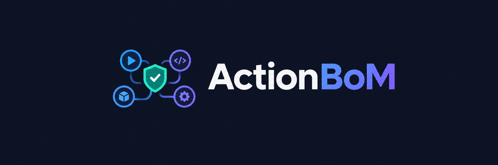

<p align="center">
  
</p>

<p align="center">
  <strong>Know every action running in your org — and whether it's safe.</strong>
</p>

<p align="center">
  Recursive SBOMs · OSV CVE scanning · Zizmor SAST · Org-wide action inventory ·
</p>

<p align="center">
  
  
  
  
  
</p>

---

## At a glance

- **Recursive SBOM per workflow** — follows every `uses:`, expands composite
  actions and reusable workflows, resolves floating refs (`v4`, `main`) to
  concrete commit SHAs. Emits CycloneDX 1.4.
- **CVE scanning** against OSV.dev with severity-graded findings and fix
  versions.
- **Static analysis** via [Zizmor](https://github.com/woodruffw/zizmor) — template
  injection, unpinned refs, dangerous triggers. SARIF 2.1.0 in the UI.
- **Org-wide action inventory** — one view of every third-party action in use,
  what versions, and which versions are vulnerable.
- **Optional Slack alerts** for new CRITICAL SCA findings and new
  template-injection SAST findings, deduped per `(action, advisory)`.

## Quick start

```bash
git clone https://github.com/YOUR_ORG/actionbom.git
cd actionbom
cp .env.example .env      # add GITHUB_TOKEN (and optionally TARGET_ORG)
docker compose up
```

Open **http://localhost:9000**. (Docker Compose maps host `9000` → container `8000`.)

- If you set `TARGET_ORG`, repos auto-import from GitHub on first boot.
- Otherwise, type your org name into the dashboard's welcome card.

The first workflow scan lands within one cron tick (default: 30 minutes).

## Configuration

All configuration lives in `.env` (copy `.env.example` to start).

**Required to get going:**

| Variable | Description |
|---|---|
| `GITHUB_TOKEN` | PAT or fine-grained token with `repo` read scope. Lifts API rate limit from 60/hr → 5000/hr and enables private repo scanning. |
| `TARGET_ORG` | GitHub org to auto-import on first boot. Leave blank to import via the dashboard's welcome card instead. |

**Tuning (sensible defaults — change only if you need to):**

| Variable | Default | Description |
|---|---|---|
| `CRON_SCHEDULE` | `*/30 * * * *` | Standard 5-field cron in UTC. Slow it down (`0 */3 * * *` or less) for orgs with >1000 repos. |
| `CRON_ENABLED` | `true` | Set `false` to run API-only (no background scanning). |
| `BATCH_SIZE` | `50` | Repos scanned per cron tick. |
| `RATE_LIMIT_THRESHOLD` | `500` | Abort a cron run if fewer than this many GitHub API requests remain. |
| `SLACK_WEBHOOK_URL` | *(empty)* | Incoming webhook URL. Leave blank to disable Slack alerts. |
| `SLACK_CC_USER_ID` | *(empty)* | Slack user ID to cc on template-injection alerts. |
| `DASHBOARD_BASE_URL` | `http://localhost:9000` | Used in Slack alert links. Set to your public URL in production. |
| `LOG_LEVEL` | `INFO` | uvicorn log level. |
| `DATABASE_URL` | *(compose-managed)* | Ignore under docker-compose — compose injects it. Set only for standalone dev against your own Postgres. |

## Architecture

Single container, port 8000 inside the container. FastAPI serves both the REST
API (`/api/*`) and the built React SPA. PostgreSQL sits alongside via
docker-compose, persisted in a named volume.

```
docker-compose ──┬── app (Python 3.11 + Node build → uvicorn on :8000)
                 │     ├── FastAPI + APScheduler cron
                 │     ├── actionbom library (SBOM + OSV scanning)
                 │     └── zizmor binary (SAST)
                 │
                 └── db (postgres:16-alpine, mounted init.sql)
```

- The cron picks the least-recently-scanned repos each tick, respects the
  rate-limit budget, and dedups unchanged workflows by file blob SHA.
- Frontend: React 19 + Vite + Tailwind, TanStack Query for state.
- All app data lives in the `actionbom` schema (see [init.sql](init.sql)).

For a deeper look at data flow, batch selection, and gotchas, see
[docs/ARCHITECTURE.md](docs/ARCHITECTURE.md).

### Data model

Everything lives in the `actionbom` Postgres schema. Five tables:

| Table | Purpose |
|---|---|
| `repositories` | Inventory of repos to scan. Optional `pod`/`subpod` columns for team/BU grouping (UI hides the filters when both are NULL). |
| `workflows` | One row per workflow scan. Holds `sbom_json`, `vulns_json`, and `sarif_result` as JSONB. |
| `org_actions` | Denormalized third-party action inventory, refreshed per workflow scan. Powers the Actions page. |
| `repo_scan_log` | `last_attempted` timestamp per repo. Drives the batch rotation order. |
| `sca_alerts_sent` | Slack dedup table keyed on `(action_name, advisory_id)`. |

No migration framework — `init.sql` is the canonical DDL and is idempotent on
every startup.

### REST API

The same endpoints the UI uses are available for scripting, CI gates, or an
external MCP wrapper. OpenAPI docs are auto-generated at **`/docs`**.

| Endpoint | Purpose |
|---|---|
| `GET  /api/health` | Health check. |
| `GET  /api/repositories` | Paginated list, supports `search`, `pod`, `subpod` filters. |
| `GET  /api/repositories/filters` | Distinct pod/subpod values for dropdowns. |
| `POST /api/repositories/import` | Bulk import an org: `{"org": "..."}`. |
| `GET  /api/workflows/{repo_id}` | Workflows for a repo. |
| `GET  /api/workflow/{workflow_id}` | Full workflow detail (SBOM, SCA, SARIF). |
| `GET  /api/actions` | Org-wide third-party action inventory. |
| `GET  /api/actions/{action_name}` | Per-action detail (versions, workflows using it, vulnerabilities). |

## Managing repositories

**Auto-import on boot.** Set `TARGET_ORG` in `.env`, restart. Any repos not yet
tracked are inserted. Idempotent — existing rows (and any manual annotations)
are preserved.

**On-demand from the dashboard.** When the repositories table is empty, the
dashboard shows a welcome card with an input for your org name.

**On-demand from the CLI.** For pulling in newly-created repos or importing a
second org:

```bash
docker compose exec app python -m app.import_repos --org your-org
```

**On-demand from the API.** For scripting/CI:

```bash
curl -X POST http://localhost:9000/api/repositories/import \
  -H "Content-Type: application/json" \
  -d '{"org": "your-org"}'
```

## Advanced: standalone CLI

The core `actionbom` Python package can also run as a standalone CLI — useful
for ad-hoc scans or CI gates without the dashboard.

```bash
python -m actionbom scan --workflow .github/workflows/ci.yml
```

See [docs/CLI.md](docs/CLI.md) for full usage.

## Development

Run the backend directly against your own Postgres (auto-reload):

```bash
cd backend
./run.sh                  # creates venv, installs deps, checks db, runs uvicorn --reload
# or manually:
pip install -r requirements.txt
uvicorn app.main:app --reload --port 8000
```

Run the frontend dev server (proxies `/api` → `http://localhost:8000`):

```bash
cd frontend
npm install
npm run dev               # http://localhost:3000
```

Zizmor is optional for local backend development — SAST is silently skipped if
the binary isn't on `PATH`. The Docker image installs it from the official
release tarball. To install locally, see
[Zizmor's installation guide](https://woodruffw.github.io/zizmor/installation/).

After frontend changes intended for the container, rebuild the image:

```bash
docker compose build
```

See [backend/README.md](backend/README.md) for development-specific notes.

## 👥 Contributors
- Alfin Joseph
- Ashwin Shenoi
- Yadhu Krishna M

## Contributing

Issues and PRs welcome. Please:

- Run the type-check (`cd frontend && npx tsc --noEmit`) before opening a PR.
- Include repro steps for bugs.
- For larger changes, open an issue first to discuss the approach.

## Acknowledgments

- [CycloneDX](https://cyclonedx.org/) for the SBOM specification
- [OSV.dev](https://osv.dev/) for the vulnerability database
- [Zizmor](https://github.com/woodruffw/zizmor) for SAST analysis
- The GitHub Actions community

## License

See the [LICENSE](LICENSE) file for details.
